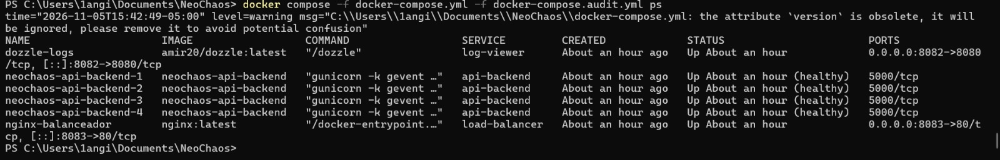
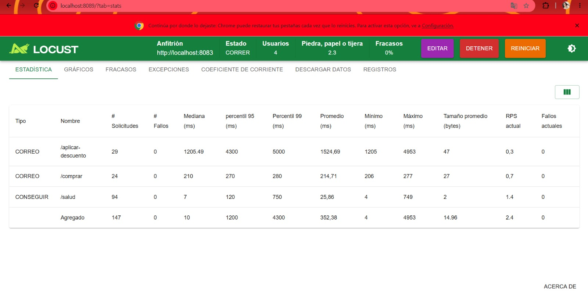

(POST_MORTEM_INCIDENTE.md):
Equipo Afectado (Nosotros):* SMART ROAD  
Equipo Saboteador: NeoGenesis AI  
Tiempo Total de Resolución Pendiente de confirmar.

1. Detección y Síntomas
El equipo identificó problemas de rendimiento y disponibilidad durante las pruebas de carga realizadas con Locust.
Síntoma en Locust: Se presentaron errores 502 y 504 durante las solicitudes al servicio.
Síntoma en Dozzle / Terminal Se investigó el comportamiento de los contenedores del backend para identificar posibles problemas de recursos.

 2. Diagnóstico y Causa Raíz
Durante la revisión del archivo docker-compose.yml, se identificó una modificación en el límite de CPU asignado al servicio api-backend.
Configuración original 0.15 CPU.
Configuración encontrada 0.05 CPU.
Alteración Reducción del límite de CPU a una tercera parte del valor original.

Esta reducción disminuyó los recursos disponibles para procesar solicitudes y pudo contribuir a los problemas de rendimiento y a los errores 502 y 504 durante las pruebas de carga.
 3. Resolución y Evaluación del Runbook
Pasos de solución
1. Se comparó la configuración recibida con la versión original del repositorio mediante Git.
2. Se identificó la reducción del límite de CPU del backend.
3. Se restauró el límite de CPU de 0.05 a 0.15.
4. Se validó la configuración de Docker Compose.
5. Se recrearon los servicios del backend para aplicar la configuración corregida.

Utilidad del Runbook Parcialmente útil.
El Runbook sirvió como referencia para orientar el diagnóstico, pero fue necesario realizar una comparación manual con Git para identificar la modificación del límite de CPU.
4. Acciones de Mejora Preventiva
Se recomienda agregar al RUNBOOK_INCIDENTES.md un procedimiento para detectar modificaciones no autorizadas en los recursos de los contenedores.
Comparar los límites de CPU y memoria con la configuración original del repositorio.
Verificar que las cuatro réplicas del backend permanezcan activas y saludables.
Revisar los errores 502 y 504 durante las pruebas de carga.
Restaurar los límites de recursos originales cuando se identifiquen alteraciones.
Ejecutar nuevamente Locust para comprobar la recuperación del servicio.

terminal mostrando las réplicas nuevamente en estado
healthy o procesando peticiones sin arrojar errores 500/502.

Locust mostrando que el tráfico volvió a la normalidad (línea verde
estable, tasa de error 0%) después del arreglo.

